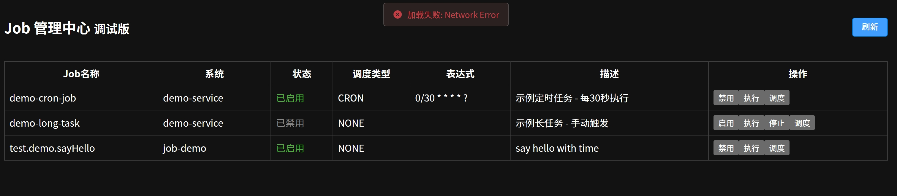

# Job 管理中心

分布式任务调度管理系统，支持 Job 自动发现、CRON/FIXED_RATE 调度、执行结果回传、在线日志、SSE 状态推送、失败告警、重试超时、分片与命名空间隔离，并提供
GitOps 基线配置发布能力。

## 技术栈

| 层级     | 技术                                                         | 证据                                                                                             |
|--------|------------------------------------------------------------|------------------------------------------------------------------------------------------------|
| 后端     | Spring Boot `3.2.5`、Java `17`、MyBatis-Plus `3.5.5`、MySQL 8 | `pom.xml:12-21,31-35`                                                                          |
| 前端     | Vue 3 + Element Plus + axios（CDN，内联在单页）                    | `job-admin/src/main/resources/static/index.html:7-10,136-280`                                  |
| 客户端集成  | Spring Boot Starter + `@Job` 注解自动注册                        | `job-executor-starter/src/main/java/com/example/jobexecutor/JobExecutorAutoConfiguration.java` |
| 测试     | JUnit 5、Mockito、MockRestServiceServer、H2                   | `job-admin/pom.xml`、`job-executor-starter/pom.xml`、`job-admin/src/test/resources/`             |
| 构建与运维  | Maven 多模块、Docker Compose、GitHub Actions CI                 | `pom.xml:24-28`、`docker-compose.yml`、`.github/workflows/ci.yml`                                |
| 前端工程骨架 | Vite `web/`（开发代理 `/api`，构建输出 `static/dist`）                | `web/vite.config.js`、`web/package.json`                                                        |

## 项目结构

```text
jobs-admin/
├── pom.xml                              # 父 POM，modules: job-admin / job-executor-starter / job-demo
├── docker-compose.yml                   # MySQL + Admin + job-demo 编排
├── .github/workflows/ci.yml             # push / PR 执行 mvn -B test
├── doc/
│   ├── architecture.md                  # 架构文档
│   ├── task-list.md                     # 扩展任务清单（25 项已完成）
│   └── change-log.md                    # 逐项改动与验证记录
├── job-admin/                           # 调度中心，端口 8080
│   ├── Dockerfile
│   └── src/main/
│       ├── java/com/example/jobadmin/
│       │   ├── controller/              # REST API（Job、调度、回调、配置同步）
│       │   ├── service/                 # 实例管理、调度下发、结果落库、告警、审计、SSE
│       │   ├── scheduler/               # JobSchedulerEngine（FIXED_RATE / CRON + DB 锁）
│       │   ├── security/                # ApiAuthFilter
│       │   ├── exception/               # GlobalExceptionHandler
│       │   ├── aop/                     # ControllerLogAspect / OperationLogAspect
│       │   ├── gitops/                  # ScheduleFileLoader
│       │   ├── entity/ / mapper/        # 6 张表的实体与 Mapper
│       │   └── service/dto/             # ExecutionResultRequest
│       └── resources/
│           ├── application.yml
│           ├── schema.sql               # 生产建表脚本
│           ├── job-schedules-baseline.yml
│           └── static/index.html        # 当前运行的管理页面
├── job-executor-starter/                # 业务系统接入 Starter
│   ├── Dockerfile（无，Starter 无独立服务）
│   └── src/main/java/com/example/jobexecutor/
│       ├── annotation/Job.java
│       ├── JobAnnotationScanner.java / HeartbeatSender.java
│       ├── JobExecutionController.java / ExecutorAuthFilter.java
│       ├── ExecutionResultReporter.java / JobLogCollector.java / RoutingPrintStream.java
│       ├── ExecutorProperties.java / JobExecutorAutoConfiguration.java
├── job-demo/                            # 示例业务系统，端口 8082
│   ├── Dockerfile
│   └── src/main/resources/application.yaml
└── web/                                 # Vite 前端工程骨架（尚未替换静态页）
    ├── package.json / vite.config.js / index.html / src/main.js
```

## 核心特性

- **零侵入接入**：业务系统引入 Starter，在 Spring Bean 方法上标注 `@Job`，启动后自动向 Admin 注册。
- **双模调度**：`FIXED_RATE` 按毫秒间隔触发；`CRON` 使用 `CronExpression` 计算并把 `next_fire_time` 持久化到数据库。
- **多实例防重**：`job_scheduler_lock` 表实现数据库锁，锁 TTL 限制在 5–30 秒。
- **执行闭环**：执行结果由 Executor 回调 Admin 落入 `job_execution_log`；失败触发 Webhook 告警。
- **可观测性**：在线日志查看（每任务内存保留最近 200 行）、SSE 实时状态推送、Controller 访问日志、写操作审计日志。
- **可靠性**：失败重试（`retryCount`/`retryIntervalMs`）、超时自动停止（`timeoutMs`）、重复执行保护（409）、长任务中断停止。
- **隔离与编排**：命名空间隔离（`namespace`）、分片参数（`shardIndex`/`shardTotal`）、DAG 依赖（`dependsOn`）。
- **安全**：Admin `/api/**` 与执行器 `/executor/**` 支持 `X-API-Token` 校验；配置导入仍需 `X-Approval-Token`。
- **GitOps**：启动时加载 `job-schedules-baseline.yml`，导入基线任务并标记 `isBaselineLocked=true`。

## 快速开始

### 0. 前置条件

- JDK 17+
- MySQL 8.0+
- Maven 3.9+（或使用 IDEA 自带 Maven）
- 浏览器（Chrome / Edge）

### 1. 构建与测试

```bash
cd jobs-admin
mvn clean test
```

`job-admin`、`job-executor-starter`、`job-demo` 均已纳入父工程 reactor，当前约 76 个测试用例会一并运行。

### 2. 初始化数据库

```bash
mysql -u root -p < job-admin/src/main/resources/schema.sql
```

注意：`application.yml` 当前默认连接 `jdbc:mysql://localhost:3306/test`，而 `schema.sql` 创建 `job_admin` 库；本地启动时请将数据源
URL 改为 `/job_admin`，或使用 `docker-compose.yml` 的环境变量覆盖。

### 3. 启动管理端

```bash
mvn -pl job-admin -am spring-boot:run
```

管理端 API 与页面均位于 `http://localhost:8080`；页面入口由 Spring Boot 默认静态映射提供：
`job-admin/src/main/resources/static/index.html`。

### 4. 启动示例业务系统

```bash
mvn -pl job-demo -am spring-boot:run
```

`job-demo` 监听 `8082`，通过 `job.executor.admin-url=http://localhost:8080` 向 Admin 注册心跳与任务。

### 5. Docker Compose 启动

```bash
docker compose up -d --build
```

Compose 会启动 MySQL、Admin（8080）与 job-demo（8082），容器间使用服务名访问，并挂载 `schema.sql` 初始化数据库。

## 业务系统接入

添加依赖：

```xml

<dependency>
    <groupId>com.example</groupId>
    <artifactId>job-executor-starter</artifactId>
    <version>1.0.0</version>
</dependency>
```

配置 `application.yaml`：

```yaml
job:
  executor:
    admin-url: http://localhost:8080
    system-code: my-service
    namespace: default
    heartbeat-interval: 5
    api-token: ""
    result-callback-enabled: true
    log-capture-enabled: true
```

定义任务：

```java

@Component
public class OrderCleanTask {
    @Job(value = "order.clean", description = "清理过期订单")
    public void clean() {
        // 业务逻辑；长任务需自行响应 Thread.currentThread().isInterrupted()
    }

    @Job(value = "order.shard", shardTotal = 3)
    public void shard(int shardIndex, int shardTotal) {
        // 分片任务需使用 (int, int) 签名
    }
}
```

## 关键配置项

| 配置项                                    | 默认值                                    | 说明                                     |
|----------------------------------------|----------------------------------------|----------------------------------------|
| `job.admin.api-token`                  | 空                                      | `/api/**` 的请求头 `X-API-Token`，为空时不校验    |
| `job.admin.executor-token`             | 空                                      | Admin 调用执行器时携带的 `X-API-Token`          |
| `job.admin.baseline-file`              | `classpath:job-schedules-baseline.yml` | GitOps 基线文件                            |
| `job.admin.instance-select-strategy`   | `ROUND_ROBIN`                          | `FIRST` / `ROUND_ROBIN` / `LEAST_LOAD` |
| `job.admin.offline-threshold`          | `30`                                   | 心跳超时秒数                                 |
| `job.admin.alert.webhook-url`          | 空                                      | 非空时推送失败/离线告警                           |
| `job.admin.import.approval-token`      | `change-me-to-a-secure-token`          | 配置导入审批令牌，生产必须修改                        |
| `job.executor.admin-url`               | `http://localhost:8080`                | Admin 地址                               |
| `job.executor.system-code`             | 无                                      | 业务系统唯一标识，必须配置                          |
| `job.executor.namespace`               | `default`                              | 命名空间                                   |
| `job.executor.heartbeat-interval`      | `10`                                   | 心跳间隔（秒）                                |
| `job.executor.api-token`               | 空                                      | 执行器 `/executor/**` 校验令牌                |
| `job.executor.result-callback-enabled` | `true`                                 | 是否上报执行结果                               |
| `job.executor.log-capture-enabled`     | `true`                                 | 是否代理 `System.out` 采集日志                 |

## REST API 概览

| 接口                               | 方法        | 说明                          |
|----------------------------------|-----------|-----------------------------|
| `/api/jobs`                      | GET       | 获取全部 Job 定义                 |
| `/api/jobs/{id}`                 | PUT       | 更新 Job 配置（调度类型、表达式、启用状态等）   |
| `/api/schedule/execute/{id}`     | POST      | 手动触发执行                      |
| `/api/schedule/stop/{id}`        | POST      | 停止长任务                       |
| `/api/schedule/running`          | GET       | 在线执行器上仍在运行的任务名              |
| `/api/schedule/events`           | GET (SSE) | 推送任务状态事件                    |
| `/api/schedule/logs`             | GET       | 查询任务在线日志（`jobName`、`limit`） |
| `/api/callback/heartbeat`        | POST      | Executor 心跳（含 `namespace`）  |
| `/api/callback/register-job`     | POST      | Executor 注册 Job             |
| `/api/callback/execution-result` | POST      | Executor 回传执行结果             |
| `/api/config/export`             | GET       | 导出全部配置                      |
| `/api/config/import`             | POST      | 导入配置（需 `X-Approval-Token`）  |
| `/executor/execute`              | POST      | 执行器接收执行指令（含分片参数）            |
| `/executor/stop`                 | POST      | 执行器停止任务                     |
| `/executor/running`              | GET       | 执行器返回运行中任务                  |
| `/executor/logs`                 | GET       | 执行器返回最近日志                   |

## 前端操作说明

| 功能    | 说明                                    |
|-------|---------------------------------------|
| 任务列表  | 显示 Job 名称、系统、状态、调度类型、表达式、描述           |
| 状态    | 已启用（绿）、已禁用（灰）、不可调度（红）、在执行（橙色）         |
| 启用/禁用 | 更新 `enabled` 与 `status`，实例离线再上线保留禁用意图 |
| 执行    | 手动触发；运行中再次触发返回“任务已在执行，提交失败”           |
| 停止    | 中断正在运行的长任务，任务代码需响应中断                  |
| 日志    | 查看执行器最近 200 行任务日志                     |
| 调度配置  | 修改 CRON / FIXED_RATE，保存后立即生效          |
| 配置管理  | 导入/导出任务配置，导入需审批 Token                 |
| 状态推送  | 通过 SSE 接收任务状态事件，无需依赖纯轮询               |

## 测试与质量

```bash
mvn test          # 全部模块，约 76 个用例
mvn verify        # 含 H2 集成测试与 Maven 插件校验
```

- 单元测试：Mockito + JUnit 5 覆盖调度、去重、实例选择、鉴权、告警、审计、重试、分片等。
- 集成测试：H2 内存库覆盖真实 MyBatis-Plus Mapper/SQL 链路（`application-test.yml`）。
- CI：`.github/workflows/ci.yml` 在 push / PR 时执行 `mvn -B test`。

## 已知边界

1. `application.yml` 本地数据源库名为 `test`，`schema.sql` 与 Docker Compose 使用 `job_admin`，本地启动需统一。
2. `web/` 是 Vite 迁移骨架，`vite.config.js` 开发代理仍指向 `http://localhost:8080`；当前运行入口仍是 `static/index.html`。
3. DAG 依赖状态保存在 Admin 进程内，多 Admin 实例部署时需改为数据库状态。
4. 日志采集通过代理 `System.out` 实现，仅保存在执行器进程内存中，重启后丢失。
5. `job-demo` 自身坐标为 `org.example:job-demo:0.0.1-SNAPSHOT`，与父工程 `com.example:job-manager:1.0.0` 不一致，但已纳入同一
   reactor。

## 页面展示


