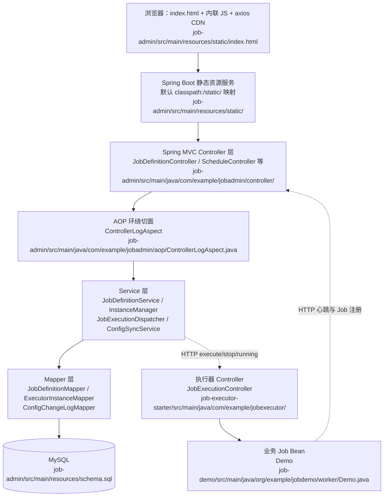
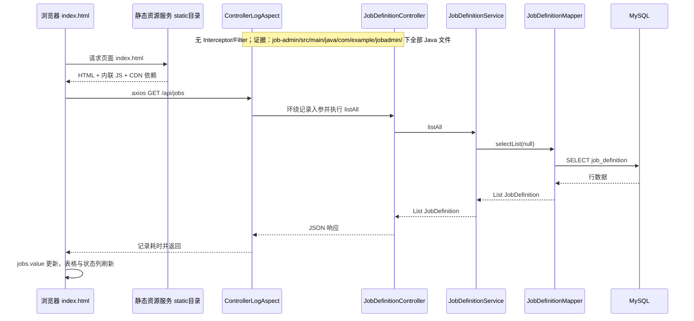
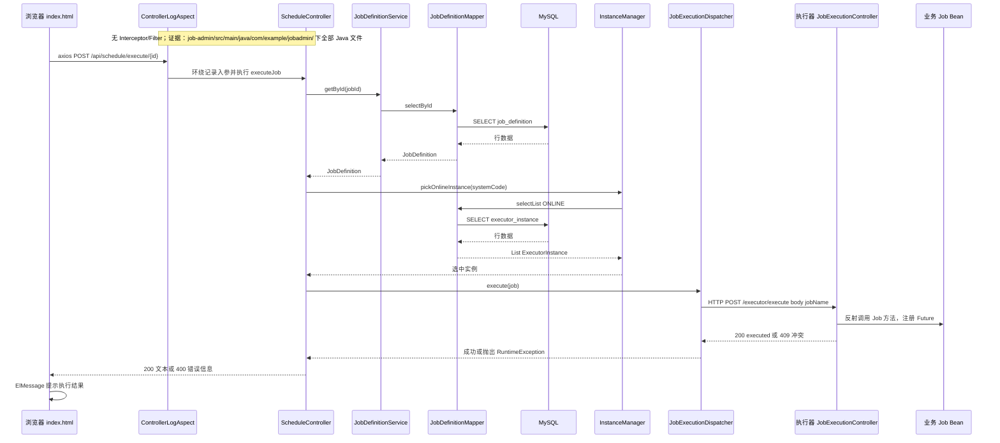

# Job 管理中心架构文档

> 项目性质说明：**这是“纯静态 HTML + AJAX”型混合项目，不是服务端渲染型混合项目**。页面是 `job-admin/src/main/resources/static/index.html` 这一个静态文件，JS 内联在该文件中，通过 axios 调用 JSON 接口；项目中没有 Thymeleaf/JSP 模板，也没有 `templates/` 目录（证据：`job-admin/pom.xml` 无模板引擎依赖；`job-admin/src/main/resources/` 下仅有 `static/`、`application.yml`、`job-schedules-baseline.yml`、`schema.sql`）。

## 1. 项目概览与分层

系统由三个 Maven 侧单元构成：父工程 `pom.xml` 声明 `job-admin` 与 `job-executor-starter` 两个模块；`job-demo` 是独立工程，不在父工程 `<modules>` 中（证据：`pom.xml:24-27`；`job-demo/pom.xml`）。`job-admin` 是调度中心（端口 8080），`job-executor-starter` 嵌入业务系统（示例业务系统 `job-demo` 端口 8082），二者通过 HTTP REST 互相调用（证据：`job-admin/src/main/resources/application.yml:1-2`；`job-demo/src/main/resources/application.yaml:1-2,8-12`；`job-admin/src/main/java/com/example/jobadmin/service/JobExecutionDispatcher.java:28-50`）。

图中不存在 Interceptor/Filter 节点：全项目 Java 文件中未发现 `HandlerInterceptor`、`Filter`、`SecurityFilterChain` 的实现或注册（证据：`job-admin/src/main/java/com/example/jobadmin/` 与 `job-executor-starter/src/main/java/com/example/jobexecutor/` 下全部 Java 文件）；唯一的横切设施是 `ControllerLogAspect`（证据：`job-admin/src/main/java/com/example/jobadmin/aop/ControllerLogAspect.java`）。

## 2. 后端分层详解

### 2.1 依赖与配置

| 文件                                                        | 关键事实                                                                                                                                                          | 证据                                |
|-----------------------------------------------------------|---------------------------------------------------------------------------------------------------------------------------------------------------------------|-----------------------------------|
| `pom.xml`                                                 | 父 POM 继承 Spring Boot `3.2.5`，Java `17`，MyBatis-Plus `3.5.5`；模块为 `job-admin`、`job-executor-starter`                                                            | `pom.xml:12-27,31-40`             |
| `job-admin/pom.xml`                                       | 依赖 `spring-boot-starter-web`、`mybatis-plus-spring-boot3-starter`、`spring-boot-starter-aop`、`mysql-connector-j`、`spring-boot-starter-test`；无模板引擎、无 Security 依赖 | `job-admin/pom.xml:14-42`         |
| `job-admin/src/main/resources/application.yml`            | 端口 `8080`；数据源 `jdbc:mysql://localhost:3306/test`；开启驼峰映射；无 `spring.mvc.static-path-pattern`、无模板配置；审批 Token 默认值 `change-me-to-a-secure-token`                   | `application.yml:1-29`            |
| `job-admin/src/main/resources/schema.sql`                 | 建库 `job_admin`，建表 `job_definition`、`executor_instance`、`config_change_log`                                                                                    | `schema.sql:1-42`                 |
| `job-admin/src/main/resources/job-schedules-baseline.yml` | 启动基线：`jobs[].name/system/scheduleType/scheduleExpr/enabled/description`                                                                                       | `job-schedules-baseline.yml:1-13` |
| `job-demo/src/main/resources/application.yaml`            | 业务系统端口 `8082`，`job.executor.admin-url` 指向 `http://localhost:8080`，`system-code: job-demo`                                                                     | `application.yaml:1-12`           |

### 2.2 Controller 端点总表

**Admin 侧（浏览器与执行器访问的接口）**

| Controller                | 基础路径            | 端点                      | 入参                                                                                        | 返回值                   | 证据                                                                                              |
|---------------------------|-----------------|-------------------------|-------------------------------------------------------------------------------------------|-----------------------|-------------------------------------------------------------------------------------------------|
| `CallbackController`      | `/api/callback` | `POST /heartbeat`       | `@RequestParam String systemCode, String host, int port`                                  | `void`                | `job-admin/src/main/java/com/example/jobadmin/controller/CallbackController.java:15,22-25`      |
| `CallbackController`      | `/api/callback` | `POST /register-job`    | `@RequestBody JobDefinition jobDef`                                                       | `void`                | 同上 `:28-31`                                                                                     |
| `ConfigSyncController`    | `/api/config`   | `GET /export`           | 无                                                                                         | `List<JobDefinition>` | `job-admin/src/main/java/com/example/jobadmin/controller/ConfigSyncController.java:16,26-30`    |
| `ConfigSyncController`    | `/api/config`   | `POST /import`          | `@RequestBody List<JobDefinition> jobs`、`@RequestHeader("X-Approval-Token") String token` | `void`                | 同上 `:32-39`                                                                                     |
| `HelloController`         | `/api/hello`    | `GET /api/hello`        | 无                                                                                         | `String`              | `job-admin/src/main/java/com/example/jobadmin/controller/HelloController.java:12-20`            |
| `JobDefinitionController` | `/api/jobs`     | `GET /api/jobs`         | 无                                                                                         | `List<JobDefinition>` | `job-admin/src/main/java/com/example/jobadmin/controller/JobDefinitionController.java:14,19-22` |
| `JobDefinitionController` | `/api/jobs`     | `PUT /{id}`             | `@PathVariable Long id`、`@RequestBody JobDefinition job`                                  | `void`                | 同上 `:24-28`                                                                                     |
| `ScheduleController`      | `/api/schedule` | `POST /execute/{jobId}` | `@PathVariable Long jobId`                                                                | `ResponseEntity<?>`   | `job-admin/src/main/java/com/example/jobadmin/controller/ScheduleController.java:24,32-48`      |
| `ScheduleController`      | `/api/schedule` | `POST /stop/{jobId}`    | `@PathVariable Long jobId`                                                                | `void`                | 同上 `:50-56`                                                                                     |
| `ScheduleController`      | `/api/schedule` | `GET /running`          | 无                                                                                         | `List<String>`        | 同上 `:59-70`                                                                                     |

**执行器侧（由 Admin 的 `JobExecutionDispatcher` 访问，浏览器不直接调用）**

| Controller               | 基础路径        | 端点              | 入参                                             | 返回值                      | 证据                                                                                                |
|--------------------------|-------------|-----------------|------------------------------------------------|--------------------------|---------------------------------------------------------------------------------------------------|
| `JobExecutionController` | `/executor` | `POST /execute` | `@RequestBody Map<String,String>`（键 `jobName`） | `ResponseEntity<String>` | `job-executor-starter/src/main/java/com/example/jobexecutor/JobExecutionController.java:32,43-74` |
| `JobExecutionController` | `/executor` | `POST /stop`    | `@RequestBody Map<String,String>`（键 `jobName`） | `String`                 | 同上 `:79-88`                                                                                       |
| `JobExecutionController` | `/executor` | `GET /running`  | 无                                              | `List<String>`           | 同上 `:93-104`                                                                                      |

### 2.3 Service 层

| Service                     | 核心方法                                                                                                                 | 主要调用方                                                                                                                                               | 证据                                                                                                                                        |
|-----------------------------|----------------------------------------------------------------------------------------------------------------------|-----------------------------------------------------------------------------------------------------------------------------------------------------|-------------------------------------------------------------------------------------------------------------------------------------------|
| `JobDefinitionService`      | `saveOrUpdate`、`listAll`、`getById`、`getEnabledJobsWithOnlineInstance`、`markUnreachableBySystem`、`markOnlineBySystem` | `CallbackController`、`JobDefinitionController`、`ScheduleController`、`ConfigSyncService`、`InstanceManager`、`JobSchedulerEngine`、`ScheduleFileLoader` | `job-admin/src/main/java/com/example/jobadmin/service/JobDefinitionService.java:20-66`；各调用方文件                                             |
| `InstanceManager`           | `heartbeat`、`checkOffline`（`@Scheduled(fixedRate=15000)`）、`pickOnlineInstance`、`listOnlineInstances`                 | `CallbackController`、`ScheduleController`、`JobExecutionDispatcher`、`JobSchedulerEngine`                                                             | `job-admin/src/main/java/com/example/jobadmin/service/InstanceManager.java:25-98`；各调用方文件                                                  |
| `JobExecutionDispatcher`    | `execute`、`stop`、`queryRunningJobs`；内部 `new RestTemplate()` 拼接 `http://{host}:{port}/executor/...`                   | `ScheduleController`、`JobSchedulerEngine`                                                                                                           | `job-admin/src/main/java/com/example/jobadmin/service/JobExecutionDispatcher.java:19-52`                                                  |
| `ConfigSyncService`         | `@Transactional applyExportedPackage(List<JobDefinition>, String)`，写审计日志并保存 Job                                      | `ConfigSyncController.importConfig`                                                                                                                 | `job-admin/src/main/java/com/example/jobadmin/service/ConfigSyncService.java:18-38`；`ConfigSyncController.java:38`                        |
| `JobAnnotationScanner`（执行器） | `scanAndRegister()` 发现 `@Job`，回调 Admin 注册；`getMethod`、`getBean` 供执行时反射                                               | `ApplicationReadyEvent` 触发；`JobExecutionController.execute` 调用 `getMethod/getBean`                                                                  | `job-executor-starter/src/main/java/com/example/jobexecutor/JobAnnotationScanner.java:23,36-38,46-99`；`JobExecutionController.java:46-47` |
| `HeartbeatSender`（执行器）      | `@PostConstruct startHeartbeat()`，定时 POST `/api/callback/heartbeat`                                                  | Spring 容器启动时自动执行                                                                                                                                    | `job-executor-starter/src/main/java/com/example/jobexecutor/HeartbeatSender.java:33-48`                                                   |
| `JobSchedulerEngine`        | `@Scheduled(fixedRate=5000) scheduleFixedRateJobs()`、`reloadAll()`                                                   | Spring 定时调度                                                                                                                                         | `job-admin/src/main/java/com/example/jobadmin/scheduler/JobSchedulerEngine.java:28-61`                                                    |
| `ScheduleFileLoader`        | `@PostConstruct loadBaseline()` 读取 YAML 基线并落库                                                                        | Spring 容器启动时自动执行                                                                                                                                    | `job-admin/src/main/java/com/example/jobadmin/gitops/ScheduleFileLoader.java:25-53`                                                       |

### 2.4 Mapper 与实体

| Mapper                   | 对应实体               | 表                   | 证据                                                                                                                                                |
|--------------------------|--------------------|---------------------|---------------------------------------------------------------------------------------------------------------------------------------------------|
| `JobDefinitionMapper`    | `JobDefinition`    | `job_definition`    | `job-admin/src/main/java/com/example/jobadmin/mapper/JobDefinitionMapper.java:7-9`；`.../entity/JobDefinition.java:9-11`；`schema.sql:5-19`         |
| `ExecutorInstanceMapper` | `ExecutorInstance` | `executor_instance` | `job-admin/src/main/java/com/example/jobadmin/mapper/ExecutorInstanceMapper.java:8-10`；`.../entity/ExecutorInstance.java:9-11`；`schema.sql:21-29` |
| `ConfigChangeLogMapper`  | `ConfigChangeLog`  | `config_change_log` | `job-admin/src/main/java/com/example/jobadmin/mapper/ConfigChangeLogMapper.java:7-9`；`.../entity/ConfigChangeLog.java:9-11`；`schema.sql:31-42`    |

三个 Mapper 均只继承 MyBatis-Plus `BaseMapper<T>`；项目中未发现 `*Mapper.xml` 文件（证据：上述三个 Mapper 文件；`job-admin/src/main/resources/` 目录清单）。

### 2.5 配置与全局设施

| 设施                   | 说明                                                                                                          | 证据                                                                                                                          |
|----------------------|-------------------------------------------------------------------------------------------------------------|-----------------------------------------------------------------------------------------------------------------------------|
| 启动与定时开关              | `JobAdminApplication` 使用 `@EnableScheduling`                                                                | `job-admin/src/main/java/com/example/jobadmin/JobAdminApplication.java:7-9`                                                 |
| AOP 日志               | `ControllerLogAspect` 环绕 `com.example.jobadmin.controller..*` 下方法，打印入参、出参与耗时                                | `job-admin/src/main/java/com/example/jobadmin/aop/ControllerLogAspect.java:14-50`                                           |
| Interceptor / Filter | 未发现任何实现或注册                                                                                                  | `job-admin/src/main/java/com/example/jobadmin/` 与 `job-executor-starter/src/main/java/com/example/jobexecutor/` 下全部 Java 文件 |
| 全局异常处理               | 未发现 `@ControllerAdvice` / `@RestControllerAdvice`                                                           | 同上                                                                                                                          |
| 安全配置                 | 未发现 `SecurityConfig` / `SecurityFilterChain`；配置导入仅用请求头 Token 等值比较                                           | `job-admin/src/main/java/com/example/jobadmin/controller/ConfigSyncController.java:32-38`                                   |
| Starter 自动装配         | `JobExecutorAutoConfiguration` 声明 `JobAnnotationScanner`、`HeartbeatSender`、`JobExecutionController` 三个 Bean | `job-executor-starter/src/main/java/com/example/jobexecutor/JobExecutorAutoConfiguration.java:25-42`                        |
| 执行器配置                | `ExecutorProperties` 绑定 `job.executor` 前缀：`adminUrl`、`systemCode`、`heartbeatInterval`                       | `job-executor-starter/src/main/java/com/example/jobexecutor/ExecutorProperties.java:11-22`                                  |

## 3. 前端页面与接口调用

`job-admin/src/main/resources/static/` 下只有 `index.html` 一个页面，是 Job 管理中心入口页兼唯一功能页：任务表格、状态列（含“在执行”）、启用/禁用/执行/停止/调度按钮和调度配置编辑弹窗均在同一文件（证据：`job-admin/src/main/resources/static/index.html:32-82,115-133`）。

JS 组织方式为**内联脚本**：Vue 3、Element Plus、axios 均通过 CDN `<script>`/`<link>` 引入（证据：同文件 `:7-10`），应用逻辑写在同文件 `:136-280` 的 `<script>` 中；`static/` 目录下无独立 `.js` 文件（证据：`job-admin/src/main/resources/static/` 目录清单）。所有请求 URL 由 `:142` 的硬编码常量 `API_BASE = 'http://localhost:8080/api'` 拼接。

| 页面操作    | 前端函数                   | HTTP 请求                                                    | 依赖的后端接口                           | 证据                                                               |
|---------|------------------------|------------------------------------------------------------|-----------------------------------|------------------------------------------------------------------|
| 加载列表与刷新 | `loadJobs()`           | `GET /api/jobs`                                            | `JobDefinitionController.listAll` | `index.html:35,164-169`；`.../JobDefinitionController.java:19-22` |
| 加载运行中状态 | `loadJobs()`           | `GET /api/schedule/running`                                | `ScheduleController.runningJobs`  | `index.html:170-176,253-255`；`.../ScheduleController.java:59-70` |
| 启用      | `enableJob()`          | `PUT /api/jobs/{id}`，body 覆盖 `status:'ENABLED'`            | `JobDefinitionController.update`  | `index.html:187-195`；`.../JobDefinitionController.java:24-28`    |
| 禁用      | `disableJob()`         | `PUT /api/jobs/{id}`，body 覆盖 `status:'DISABLED'`           | 同上                                | `index.html:197-205`                                             |
| 执行      | `executeJob()`         | `POST /api/schedule/execute/{id}`                          | `ScheduleController.executeJob`   | `index.html:207-214`；`.../ScheduleController.java:32-48`         |
| 停止      | `stopJob()`            | `POST /api/schedule/stop/{id}`                             | `ScheduleController.stopJob`      | `index.html:216-223`；`.../ScheduleController.java:50-56`         |
| 保存调度配置  | `saveScheduleConfig()` | `PUT /api/jobs/{id}`，body 覆盖 `scheduleType`、`scheduleExpr` | `JobDefinitionController.update`  | `index.html:233-248`                                             |

## 4. 前后端接口映射总表

| # | 前端调用（方法 + 路径；证据）                                                                           | 后端匹配端点（证据）                                                                                                                                           | 方法匹配 | 参数字段名核对                                                                                                                                           | 结论 |
|---|--------------------------------------------------------------------------------------------|------------------------------------------------------------------------------------------------------------------------------------------------------|------|---------------------------------------------------------------------------------------------------------------------------------------------------|----|
| 1 | `GET /api/jobs`（`job-admin/src/main/resources/static/index.html:167`）                      | `GET /api/jobs`，`JobDefinitionController.listAll()`（`job-admin/src/main/java/com/example/jobadmin/controller/JobDefinitionController.java:14,19-22`） | 一致   | 前端无参数；后端无 `@RequestParam`/`@RequestBody`                                                                                                          | ✅  |
| 2 | `GET /api/schedule/running`（`index.html:171`）                                              | `GET /api/schedule/running`，`ScheduleController.runningJobs()`（`.../controller/ScheduleController.java:24,59-70`）                                    | 一致   | 双方均无参数                                                                                                                                            | ✅  |
| 3 | `PUT /api/jobs/{job.id}`，body `{...job, status:'ENABLED'}`（`index.html:189`）               | `PUT /api/jobs/{id}`，`JobDefinitionController.update`（`.../JobDefinitionController.java:24-28`）                                                      | 一致   | 路径段取 `job.id`，后端声明 `@PathVariable Long id`；body 字段由 `...job` 展开并覆盖 `status`，后端 `@RequestBody JobDefinition` 含 `status`、`jobName`、`systemCode` 等字段 | ✅  |
| 4 | `PUT /api/jobs/{job.id}`，body `{...job, status:'DISABLED'}`（`index.html:199`）              | 同 #3                                                                                                                                                 | 一致   | 同 #3                                                                                                                                              | ✅  |
| 5 | `PUT /api/jobs/{job.id}`，body `{...job, scheduleType, scheduleExpr}`（`index.html:237-241`） | 同 #3                                                                                                                                                 | 一致   | `scheduleType`、`scheduleExpr` 均在 `JobDefinition` 实体中（`job-admin/src/main/java/com/example/jobadmin/entity/JobDefinition.java:21-22`）              | ✅  |
| 6 | `POST /api/schedule/execute/{job.id}`（`index.html:209`）                                    | `POST /api/schedule/execute/{jobId}`，`ScheduleController.executeJob`（`.../ScheduleController.java:24,32-48`）                                         | 一致   | 路径段取 `job.id`，后端变量名 `jobId`（按位置绑定）；无 body                                                                                                         | ✅  |
| 7 | `POST /api/schedule/stop/{job.id}`（`index.html:218`）                                       | `POST /api/schedule/stop/{jobId}`，`ScheduleController.stopJob`（`.../ScheduleController.java:24,50-56`）                                               | 一致   | 同上；无 body。该按钮仅在 `job.longRunning` 为真时渲染（`index.html:77`）                                                                                          | ✅  |

**前端调用了但后端不存在的端点**：无 ⚠️ 项。

**后端存在但前端页面未调用的端点**：

| 端点                                                                     | 实际调用方                                                                      | 证据                                                                                                                                                                                            |
|------------------------------------------------------------------------|----------------------------------------------------------------------------|-----------------------------------------------------------------------------------------------------------------------------------------------------------------------------------------------|
| `GET /api/hello`                                                       | 无（健康检查示例）                                                                  | `job-admin/src/main/java/com/example/jobadmin/controller/HelloController.java:12-18`                                                                                                          |
| `GET /api/config/export`、`POST /api/config/import`                     | 无（导入需 body `jobs` + 请求头 `X-Approval-Token`）                                | `job-admin/src/main/java/com/example/jobadmin/controller/ConfigSyncController.java:16,26-38`                                                                                                  |
| `POST /api/callback/heartbeat`                                         | 执行器 `HeartbeatSender`、`JobAnnotationScanner`；参数 `systemCode`、`host`、`port` | `job-executor-starter/src/main/java/com/example/jobexecutor/HeartbeatSender.java:40-43`；`.../JobAnnotationScanner.java:67-70`                                                                 |
| `POST /api/callback/register-job`                                      | 执行器 `JobAnnotationScanner`；body 为 `JobDefinition` 字段                       | `job-executor-starter/src/main/java/com/example/jobexecutor/JobAnnotationScanner.java:72-85`                                                                                                  |
| `POST /executor/execute`、`POST /executor/stop`、`GET /executor/running` | Admin 侧 `JobExecutionDispatcher`；body 键 `jobName`                          | `job-admin/src/main/java/com/example/jobadmin/service/JobExecutionDispatcher.java:28-50`；`job-executor-starter/src/main/java/com/example/jobexecutor/JobExecutionController.java:32,43,79,93` |

## 5. 数据流

### 5.1 读操作示例：加载 Job 列表

证据：`job-admin/src/main/resources/static/index.html:164-169,253-255`；`job-admin/src/main/java/com/example/jobadmin/controller/JobDefinitionController.java:19-22`；`job-admin/src/main/java/com/example/jobadmin/service/JobDefinitionService.java:42-44`；`job-admin/src/main/java/com/example/jobadmin/mapper/JobDefinitionMapper.java:7-9`；`job-admin/src/main/java/com/example/jobadmin/aop/ControllerLogAspect.java:25-49`。

### 5.2 写操作示例：点击“执行”下发任务

证据：`job-admin/src/main/resources/static/index.html:207-214`；`job-admin/src/main/java/com/example/jobadmin/controller/ScheduleController.java:32-48`；`job-admin/src/main/java/com/example/jobadmin/service/JobDefinitionService.java:64-66`；`job-admin/src/main/java/com/example/jobadmin/service/InstanceManager.java:84-91`；`job-admin/src/main/java/com/example/jobadmin/service/JobExecutionDispatcher.java:23-36`；`job-executor-starter/src/main/java/com/example/jobexecutor/JobExecutionController.java:43-74`；`job-demo/src/main/java/org/example/jobdemo/worker/Demo.java:20-32`。

## 6. 静态资源与模板机制

项目未配置自定义静态资源映射：`application.yml` 中没有 `spring.mvc.static-path-pattern` / `spring.mvc.static-locations`，全项目也没有 `WebMvcConfigurer` 实现（证据：`job-admin/src/main/resources/application.yml` 全文；`job-admin/src/main/java/com/example/jobadmin/` 下全部 Java 文件）。因此 `job-admin/src/main/resources/static/index.html` 由 Spring Boot 默认的 `classpath:/static/` 映射提供服务；浏览器访问首页后，Vue 3、Element Plus、axios 从外部 CDN 加载，页面渲染完全在浏览器完成（证据：`job-admin/src/main/resources/static/index.html:7-10,136-280`）。

模板引擎方面：无 Thymeleaf/JSP/Freemarker 依赖（证据：`job-admin/pom.xml:14-42`）；无 `templates/` 目录（证据：`job-admin/src/main/resources/` 目录清单）；前端代码中无 `th:action`、`th:href`、`@{...}` 等服务端渲染 URL（证据：`job-admin/src/main/resources/static/index.html` 全文）。因此不存在 Controller → Model → 模板渲染链路，所有数据经由 axios 获取 JSON 后由 Vue 更新 DOM（证据：`index.html:167-172,253-255`）。

## 7. 关键设计决策与风险点

1. **前端 API 地址硬编码，环境切换困难**：`API_BASE = 'http://localhost:8080/api'` 写死在页面脚本中，部署到其他主机或端口必须改 HTML（证据：`job-admin/src/main/resources/static/index.html:142`）。
2. **缺少统一异常处理，错误格式不一致**：全项目无 `@ControllerAdvice`（证据：`job-admin/src/main/java/com/example/jobadmin/` 下全部 Java 文件）。`ConfigSyncController.importConfig` 直接抛 `RuntimeException("审批Token无效")`（证据：`job-admin/src/main/java/com/example/jobadmin/controller/ConfigSyncController.java:35-36`），而 `ScheduleController.executeJob` 用 `ResponseEntity.badRequest().body(...)` 返回字符串（证据：`job-admin/src/main/java/com/example/jobadmin/controller/ScheduleController.java:37-46`）；前端只能针对 execute 读取 `e.response?.data`，其他操作统一显示“操作失败/停止失败”（证据：`index.html:192-193,211-212,220-221`）。
3. **AOP 排除条件实际未排除目标方法**：切点用 `!execution(...heartbeat(..)) || !execution(...listAll(..))`，对任一单个方法该析取式恒为真，心跳和列表查询仍会被环绕；类注释声称这两类高频接口“不在切面范围内”，与代码行为不一致（证据：`job-admin/src/main/java/com/example/jobadmin/aop/ControllerLogAspect.java:8-10,22-24`）。
4. **数据源库名与建表脚本不一致**：`application.yml` 连接 `jdbc:mysql://localhost:3306/test`，而 `schema.sql` 执行 `CREATE DATABASE job_admin; USE job_admin;`（证据：`job-admin/src/main/resources/application.yml:6`；`job-admin/src/main/resources/schema.sql:2-3`）；按脚本建表后，应用默认连接的是 `test` 库。
5. **审批 Token 使用默认值且无其他鉴权**：配置中 `approval-token: change-me-to-a-secure-token`（注释标明生产必须修改），配置导入仅做等值比较，其他 Admin 接口和浏览器页面无鉴权措施（证据：`job-admin/src/main/resources/application.yml:25-27`；`job-admin/src/main/java/com/example/jobadmin/controller/ConfigSyncController.java:32-38`）。
