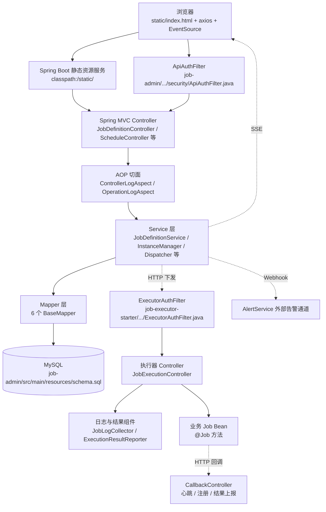
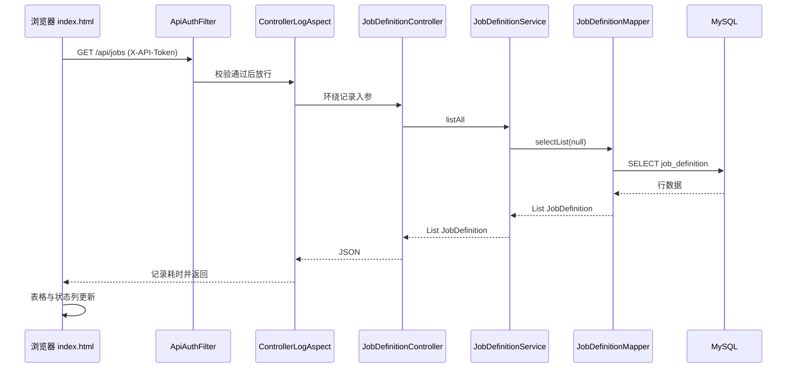
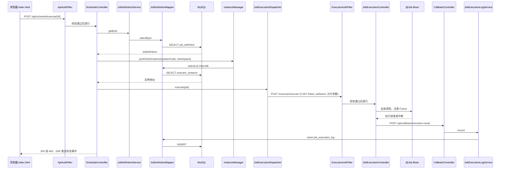

# Job 管理中心架构文档

> 项目性质：**当前运行入口是“纯静态 HTML + AJAX/SSE”型混合项目，不是服务端渲染型**。管理页面是 `job-admin/src/main/resources/static/index.html`，Vue 3 / Element Plus / axios 通过 CDN 引入，JS 内联在该文件中；项目没有 Thymeleaf/JSP 依赖或 `templates/` 目录（证据：`job-admin/pom.xml:14-42`；`job-admin/src/main/resources/` 目录清单）。另有一个 Vite 前端工程骨架 `web/`，但尚未替换静态页（证据：`web/package.json`、`web/vite.config.js`、`web/src/main.js`）。

## 1. 项目概览与分层

父工程 `pom.xml` 声明三个模块：`job-admin`（调度中心，8080）、`job-executor-starter`（业务系统接入 Starter）、`job-demo`（示例业务系统，8082），三者已纳入同一 Maven reactor（证据：`pom.xml:24-28`；`job-demo/pom.xml:5-10`）。Admin 与执行器通过 HTTP REST 双向通信：Admin 下发 execute/stop/running/logs，执行器回调 heartbeat/register-job/execution-result（证据：`job-admin/src/main/java/com/example/jobadmin/service/JobExecutionDispatcher.java`；`job-executor-starter/src/main/java/com/example/jobexecutor/JobAnnotationScanner.java`）。

图中不存在 Interceptor：全项目未发现 `HandlerInterceptor` 实现；但存在两个 Filter：`ApiAuthFilter` 与 `ExecutorAuthFilter`（证据：`job-admin/src/main/java/com/example/jobadmin/security/ApiAuthFilter.java`；`job-executor-starter/src/main/java/com/example/jobexecutor/ExecutorAuthFilter.java`）。

## 2. 后端分层详解

### 2.1 依赖与配置

| 文件 | 关键事实 | 证据 |
|---|---|---|
| `pom.xml` | Spring Boot `3.2.5`、Java `17`、MyBatis-Plus `3.5.5`；modules 为 `job-admin`、`job-executor-starter`、`job-demo` | `pom.xml:12-28,31-40` |
| `job-admin/pom.xml` | `starter-web`、`mybatis-plus-spring-boot3-starter`、`starter-aop`、`mysql-connector-j`、`starter-test`、H2（test） | `job-admin/pom.xml:14-47` |
| `job-admin/src/main/resources/application.yml` | 端口 `8080`；数据源 `jdbc:mysql://localhost:3306/test`；`api-token`/`executor-token` 默认空；`instance-select-strategy: ROUND_ROBIN`；`offline-threshold: 30`；审批 Token 默认 `change-me-to-a-secure-token` | `application.yml:1-35` |
| `job-admin/src/main/resources/schema.sql` | 建库 `job_admin`，含 6 张表：`job_definition`、`executor_instance`、`config_change_log`、`job_scheduler_lock`、`job_execution_log`、`operation_log` | `schema.sql:1-90` |
| `job-admin/src/main/resources/job-schedules-baseline.yml` | 2 条基线任务（CRON 示例与禁用长任务） | `job-schedules-baseline.yml:1-13` |
| `job-demo/src/main/resources/application.yaml` | 端口 `8082`；`admin-url: http://localhost:8080`；`system-code: job-demo`；`namespace: default`；`heartbeat-interval: 5` | `application.yaml:1-14` |
| `docker-compose.yml` | MySQL 8 + Admin + job-demo；容器间使用 `mysql:3306/job_admin`、`http://job-admin:8080` | `docker-compose.yml` |

### 2.2 Controller 端点总表

**Admin 侧**

| Controller | 基础路径 | 端点 | 入参 | 返回值 | 证据 |
|---|---|---|---|---|---|
| `HelloController` | `/api/hello` | `GET /api/hello` | 无 | `String` | `job-admin/src/main/java/com/example/jobadmin/controller/HelloController.java:12-20` |
| `JobDefinitionController` | `/api/jobs` | `GET /api/jobs` | 无 | `List<JobDefinition>` | `.../controller/JobDefinitionController.java:14-22` |
| `JobDefinitionController` | `/api/jobs` | `PUT /{id}` | `@PathVariable Long id` + `@RequestBody JobDefinition` | `void` | 同上 `:24-28` |
| `ConfigSyncController` | `/api/config` | `GET /export` | 无 | `List<JobDefinition>` | `.../controller/ConfigSyncController.java:16-30` |
| `ConfigSyncController` | `/api/config` | `POST /import` | `@RequestBody List<JobDefinition>` + `@RequestHeader("X-Approval-Token")` | `void` | 同上 `:32-39` |
| `CallbackController` | `/api/callback` | `POST /heartbeat` | `systemCode`、`host`、`port`、`namespace`（默认 `default`） | `void` | `.../controller/CallbackController.java:19-25` |
| `CallbackController` | `/api/callback` | `POST /register-job` | `@RequestBody JobDefinition` | `void` | 同上 `:28-31` |
| `CallbackController` | `/api/callback` | `POST /execution-result` | `@RequestBody ExecutionResultRequest` | `void` | 同上 `:34-37` |
| `ScheduleController` | `/api/schedule` | `POST /execute/{jobId}` | `@PathVariable Long jobId` | `ResponseEntity<?>` | `.../controller/ScheduleController.java:24-48` |
| `ScheduleController` | `/api/schedule` | `POST /stop/{jobId}` | `@PathVariable Long jobId` | `void` | 同上 `:50-56` |
| `ScheduleController` | `/api/schedule` | `GET /events` | 无 | `SseEmitter` | 同上 `:59-70` |
| `ScheduleController` | `/api/schedule` | `GET /running` | 无 | `List<String>` | 同上 `:73-84` |
| `ScheduleController` | `/api/schedule` | `GET /logs` | `@RequestParam jobName`、`limit`（默认 200） | `ResponseEntity<?>` | 同上 `:87-104` |

**执行器侧（由 Admin 调用）**

| Controller | 基础路径 | 端点 | 入参 | 返回值 | 证据 |
|---|---|---|---|---|---|
| `JobExecutionController` | `/executor` | `POST /execute` | body：`jobName`、`shardIndex`、`shardTotal` | `ResponseEntity<String>`（200/400/409） | `job-executor-starter/src/main/java/com/example/jobexecutor/JobExecutionController.java:43-74` |
| `JobExecutionController` | `/executor` | `POST /stop` | body：`jobName` | `String` | 同上 `:79-88` |
| `JobExecutionController` | `/executor` | `GET /running` | 无 | `List<String>` | 同上 `:93-104` |
| `JobExecutionController` | `/executor` | `GET /logs` | `jobName`、`limit`（默认 200） | `List<String>` | 同上 `:109-116` |

### 2.3 Service 与全局设施

| 类 | 职责 | 证据 |
|---|---|---|
| `JobDefinitionService` | 注册去重、状态流转、保留 `enabled` 管理员意图、持久化 `next_fire_time` | `job-admin/src/main/java/com/example/jobadmin/service/JobDefinitionService.java` |
| `InstanceManager` | 心跳注册、离线检测、实例选择策略（FIRST/ROUND_ROBIN/LEAST_LOAD） | `.../service/InstanceManager.java`、`.../service/InstanceSelectStrategy.java` |
| `JobExecutionDispatcher` | 调用执行器接口、失败重试、超时停止、透传错误体、携带执行器 Token | `.../service/JobExecutionDispatcher.java` |
| `JobSchedulerEngine` | 每 5 秒扫描 FIXED_RATE/CRON，检查 `depends_on`，数据库锁防重 | `.../scheduler/JobSchedulerEngine.java` |
| `JobExecutionLogService` | 执行结果回调落库 | `.../service/JobExecutionLogService.java` |
| `AlertService` | Webhook 告警，URL 为空时不发送 | `.../service/AlertService.java` |
| `JobEventBus` | SSE 事件总线，向浏览器推送 `job-status` 事件 | `.../service/JobEventBus.java` |
| `OperationLogService` | 写操作审计落库 | `.../service/OperationLogService.java` |
| `ConfigSyncService` | 配置导入事务与变更日志 | `.../service/ConfigSyncService.java` |
| `ScheduleFileLoader` | 启动加载 YAML 基线并置 `isBaselineLocked=true` | `.../gitops/ScheduleFileLoader.java` |
| `ApiAuthFilter` | `/api/**` 的 `X-API-Token` 校验（Token 为空则不校验） | `.../security/ApiAuthFilter.java` |
| `GlobalExceptionHandler` | 统一异常响应 `{"code","message"}` | `.../exception/GlobalExceptionHandler.java` |
| `ControllerLogAspect` | Controller 出入参/耗时日志，排除心跳与列表查询 | `.../aop/ControllerLogAspect.java` |
| `OperationLogAspect` | POST/PUT/DELETE 成功后写审计，排除 CallbackController | `.../aop/OperationLogAspect.java` |
| `JobAnnotationScanner` | 扫描 `@Job`，注册心跳与任务定义 | `job-executor-starter/.../JobAnnotationScanner.java` |
| `HeartbeatSender` | 定时心跳（携带 namespace） | `job-executor-starter/.../HeartbeatSender.java` |
| `ExecutionResultReporter` | 执行结束回调 Admin `/api/callback/execution-result` | `job-executor-starter/.../ExecutionResultReporter.java` |
| `JobLogCollector` / `RoutingPrintStream` | 代理 `System.out` 按任务采集最近 200 行日志 | `job-executor-starter/.../JobLogCollector.java`、`RoutingPrintStream.java` |
| `ExecutorAuthFilter` | `/executor/**` 的 `X-API-Token` 校验 | `job-executor-starter/.../ExecutorAuthFilter.java` |

### 2.4 Mapper 与实体

| Mapper | 实体 | 表 | 证据 |
|---|---|---|---|
| `JobDefinitionMapper` | `JobDefinition` | `job_definition` | `job-admin/src/main/java/com/example/jobadmin/mapper/JobDefinitionMapper.java`；`entity/JobDefinition.java`；`schema.sql` |
| `ExecutorInstanceMapper` | `ExecutorInstance` | `executor_instance` | 同上（对应文件） |
| `ConfigChangeLogMapper` | `ConfigChangeLog` | `config_change_log` | 同上（对应文件） |
| `JobExecutionLogMapper` | `JobExecutionLog` | `job_execution_log` | 同上（对应文件） |
| `OperationLogMapper` | `OperationLog` | `operation_log` | 同上（对应文件） |
| `SchedulerLockMapper` | `SchedulerLock` | `job_scheduler_lock` | 同上（对应文件） |

六个 Mapper 均只继承 MyBatis-Plus `BaseMapper<T>`，无 XML Mapper 文件（证据：上述 Mapper 文件；`job-admin/src/main/resources/` 目录清单）。`schema.sql` 中不存在 `api_token` 列，Token 仅在配置与请求头中流转（证据：`schema.sql` 全文；`application.yml`）。

## 3. 前端页面与接口调用

当前运行页面是 `job-admin/src/main/resources/static/index.html`：任务表格、状态列（含“在执行”）、启用/禁用/执行/停止/日志/调度/配置管理按钮与弹窗均在该文件（证据：`index.html:32-140`）。JS 为内联脚本，依赖从 CDN 加载（证据：`index.html:7-10,136-280`）；`API_BASE = '/api'` 为相对路径，页面无硬编码 localhost（证据：`index.html:142`）。

| 页面操作 | HTTP 请求 | 依赖的后端接口 |
|---|---|---|
| 加载列表 | `GET /api/jobs` | `JobDefinitionController.listAll` |
| 加载运行中状态 | `GET /api/schedule/running` | `ScheduleController.runningJobs` |
| 启用/禁用 | `PUT /api/jobs/{id}`（body 含 `status`、`enabled`） | `JobDefinitionController.update` |
| 执行 / 停止 | `POST /api/schedule/execute/{id}` / `POST /api/schedule/stop/{id}` | `ScheduleController` |
| 日志 | `GET /api/schedule/logs?jobName=&limit=200` | `ScheduleController.logs` |
| 配置导出/导入 | `GET /api/config/export` / `POST /api/config/import` | `ConfigSyncController` |
| 状态事件 | `EventSource('/api/schedule/events')` | `ScheduleController.events` |

`web/` 目录是 Vite 工程骨架：`web/vite.config.js` 配置开发端口 5173、代理 `/api → http://localhost:8080`，构建输出到 `job-admin/src/main/resources/static/dist`；`web/src/main.js` 目前仅演示 `GET /api/jobs`（证据：`web/vite.config.js`、`web/src/main.js`）。

## 4. 前后端接口映射总表

| # | 前端调用 | 后端端点 | 方法/字段核对 | 结论 |
|---|---|---|---|---|
| 1 | `GET /api/jobs` | `JobDefinitionController.listAll`（`GET /api/jobs`） | 一致，无参数 | ✅ |
| 2 | `GET /api/schedule/running` | `ScheduleController.runningJobs` | 一致 | ✅ |
| 3 | `PUT /api/jobs/{id}`（启用/禁用/调度保存） | `JobDefinitionController.update` | 路径 `id` + body `JobDefinition` 字段一致 | ✅ |
| 4 | `POST /api/schedule/execute/{id}` | `ScheduleController.executeJob` | 路径参数按位置绑定 | ✅ |
| 5 | `POST /api/schedule/stop/{id}` | `ScheduleController.stopJob` | 同上 | ✅ |
| 6 | `GET /api/schedule/logs?jobName=&limit=` | `ScheduleController.logs` | `@RequestParam` 字段名一致 | ✅ |
| 7 | `GET /api/config/export` | `ConfigSyncController.exportAll` | 一致 | ✅ |
| 8 | `POST /api/config/import`（含 `X-API-Token`、`X-Approval-Token`） | `ConfigSyncController.importConfig` | 请求头与后端声明一致 | ✅ |
| 9 | `EventSource /api/schedule/events` | `ScheduleController.events` | 一致，`text/event-stream` | ✅ |

**前端调用了但后端不存在的端点**：无 ⚠️ 项。

**后端存在但页面未直接调用的端点**：`GET /api/hello`；`POST /api/callback/heartbeat`、`/register-job`、`/execution-result`（由执行器调用）；`/executor/execute`、`/executor/stop`、`/executor/running`、`/executor/logs`（由 Admin `JobExecutionDispatcher` 调用）。证据：第 2.2 节所列 Controller 文件。

## 5. 数据流

### 5.1 读操作：加载 Job 列表

证据：`job-admin/src/main/resources/static/index.html`；`.../security/ApiAuthFilter.java`；`.../aop/ControllerLogAspect.java`；`.../controller/JobDefinitionController.java`；`.../service/JobDefinitionService.java`；`.../mapper/JobDefinitionMapper.java`。

### 5.2 写操作：执行任务并回传结果

证据：`job-admin/src/main/java/com/example/jobadmin/controller/ScheduleController.java`；`.../service/JobDefinitionService.java`；`.../service/InstanceManager.java`；`.../service/JobExecutionDispatcher.java`；`.../service/JobExecutionLogService.java`；`job-executor-starter/src/main/java/com/example/jobexecutor/JobExecutionController.java`、`ExecutionResultReporter.java`；`.../controller/CallbackController.java`。

## 6. 静态资源与模板机制

`application.yml` 未配置 `spring.mvc.static-path-pattern` / `static-locations`，项目也没有 `WebMvcConfigurer` 实现，因此 `job-admin/src/main/resources/static/index.html` 由 Spring Boot 默认 `classpath:/static/` 映射提供服务（证据：`application.yml` 全文；`job-admin/src/main/java/com/example/jobadmin/` 下全部 Java 文件）。Vite 工程 `web/` 尚未产出 `static/dist`，当前不影响运行（证据：`web/vite.config.js`；`static/` 目录清单）。

项目无 Thymeleaf/JSP/Freemarker 依赖、无 `templates/` 目录、无 `th:action`/`@{...}`，因此不存在 Controller → Model → 模板渲染链路；数据由 axios 获取 JSON 或 SSE 事件后由 Vue 更新 DOM（证据：`job-admin/pom.xml`；`index.html` 全文）。

## 7. 关键设计决策与风险点

1. **本地数据源库名与建表脚本/Compose 不一致**：`application.yml` 连接 `jdbc:mysql://localhost:3306/test`，而 `schema.sql` 创建 `job_admin` 库、`docker-compose.yml` 也使用 `job_admin`（证据：`application.yml:6`；`schema.sql:2-3`；`docker-compose.yml`）。本地启动需手动统一。
2. **默认令牌仍为不安全值或空值**：`job.admin.import.approval-token` 默认 `change-me-to-a-secure-token`；`api-token` 与 `executor-token` 默认为空，为空时 Filter 不校验（证据：`application.yml`；`ApiAuthFilter.java`；`ExecutorAuthFilter.java`）。生产必须显式配置。
3. **Web 工程骨架仍有硬编码地址**：`web/vite.config.js` 的开发代理指向 `http://localhost:8080`；`web/src/main.js` 仅为最小示例，完整功能尚未迁移（证据：`web/vite.config.js`、`web/src/main.js`）。
4. **日志与 DAG 状态的持久性有限**：任务日志只保存在执行器进程内存（`JobLogCollector` 最多 200 行/任务），DAG 依赖状态保存在 Admin 进程内 `triggeredAt` Map；多实例或重启后行为需依赖数据库补强（证据：`job-executor-starter/.../JobLogCollector.java`；`job-admin/.../scheduler/JobSchedulerEngine.java`）。
5. **模块坐标与容器构建未完全统一**：`job-demo` 坐标为 `org.example:job-demo:0.0.1-SNAPSHOT`，与父工程 `com.example:job-manager:1.0.0` 不一致；Dockerfile 已提供但未在本机验证镜像构建（证据：`pom.xml:5-10`、`job-demo/pom.xml:11-13`、`job-admin/Dockerfile`、`job-demo/Dockerfile`）。
